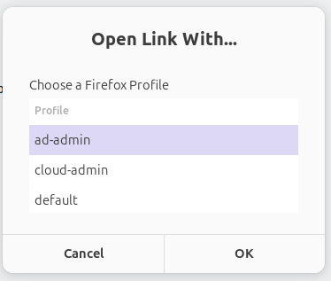

# Firefox Profile Picker

When you click a link in any app on Ubuntu, the system hands it to whatever is registered as the default browser. Firefox Profile Picker intercepts that handoff and shows a dialog so you can choose which Firefox profile to open the link in — useful if you keep separate profiles for work, personal browsing, or different accounts.



## How it works

Three files make up the project:

**`firefox-profile-picker.sh`**
The core script. It is registered as the system's default handler for `http://` and `https://` links, so it receives the URL as its first argument whenever you open a link from outside Firefox. It reads `~/.mozilla/firefox/profiles.ini` (or the Snap equivalent) to get the list of profile names, presents them in a [zenity](https://help.gnome.org/users/zenity/) dialog, and then launches Firefox with the chosen profile via `firefox -P <profile>`.

**`firefox-profile-picker.desktop`**
A standard [XDG desktop entry](https://specifications.freedesktop.org/desktop-entry-spec/latest/) that describes the app to GNOME. It declares the script as a handler for `x-scheme-handler/http` and `x-scheme-handler/https`, which is what allows it to appear as a "browser" that the system can route links to. The `NoDisplay=true` flag keeps it out of the app grid — it is a handler, not something you launch manually.

**`install.sh`**
Copies the script to `~/.local/bin`, writes a copy of the desktop entry with the correct `Exec` path, registers the app as the default MIME handler for HTTP and HTTPS links, and rebuilds the desktop database.

## Requirements

- Ubuntu (or another GNOME-based distro)
- Firefox installed via **apt** or **snap**
- `zenity` — install it if missing:

  ```sh
  sudo apt install zenity
  ```

## Installation

1. Clone the repository anywhere on your machine:

   ```sh
   git clone https://github.com/your-username/firefox-profilepicker-ubuntu.git
   cd firefox-profilepicker-ubuntu
   ```

2. Make the install script executable and run it:

   ```sh
   chmod +x install.sh
   ./install.sh
   ```

That's it. The installer will:

- Copy `firefox-profile-picker.sh` to `~/.local/bin/firefox-profile-picker`
- Write the desktop entry to `~/.local/share/applications/`
- Register it as the default handler for `http://` and `https://` links

> **Note:** If `~/.local/bin` is not on your `$PATH`, the installer will print the one line you need to add to your `~/.bashrc` or `~/.zshrc`.

## Usage

Once installed, just click any link in any app (email client, Slack, terminal, etc.). Instead of Firefox opening immediately, the profile picker dialog appears. Select a profile and click OK — Firefox opens the link in that profile.

If you cancel the dialog, nothing opens.

## Uninstalling

```sh
rm ~/.local/bin/firefox-profile-picker
rm ~/.local/share/applications/firefox-profile-picker.desktop
update-desktop-database ~/.local/share/applications
xdg-mime default firefox.desktop x-scheme-handler/http x-scheme-handler/https
```

The last command restores Firefox as the plain default browser. Replace `firefox.desktop` with whichever desktop entry matches your Firefox installation if needed (`/usr/share/applications/` and `~/.local/share/applications/` are the places to look).